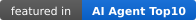

# 入选徽章 / Featured Badge

如果你的项目入选了 [AI Agent Top10](https://wjf1.github.io/ai-agent-top10/) 的任意一期日榜 / 周榜，欢迎把徽章挂到你的 README——完全自愿，徽章只是一个静态 SVG（自托管在本仓库 `docs/` 下，无第三方依赖）。

If your project appears on any daily / weekly edition of [AI Agent Top10](https://wjf1.github.io/ai-agent-top10/), feel free to put the badge on your README — entirely optional; the badge is a plain self-hosted SVG (no third-party service involved).

## 使用 / Usage

把下面一行贴进你的 README 即可 / Paste this single line into your README:

```markdown
[](https://wjf1.github.io/ai-agent-top10/)
```

效果 / Preview:

[](https://wjf1.github.io/ai-agent-top10/)

## 怎么确认入选 / How to check

- 打开 [每日榜单](https://wjf1.github.io/ai-agent-top10/)，按 `Ctrl+F` 搜索 `owner/repo`；
- 或在 [归档页](https://wjf1.github.io/ai-agent-top10/archive/) 按日期回看历史榜单；
- 也可直接查开放数据 `https://wjf1.github.io/ai-agent-top10/data/projects.json`（全量项目索引，含收录日期）。

- Open the [daily board](https://wjf1.github.io/ai-agent-top10/) and search `owner/repo`;
- or browse any past edition on the [archive page](https://wjf1.github.io/ai-agent-top10/archive/);
- the open dataset at `https://wjf1.github.io/ai-agent-top10/data/projects.json` contains the full project index.

> 说明：榜单基于 GitHub star 真实增量与 8 个可解释维度加权打分，每日自动巡检；徽章不代表官方 GitHub 认可，也不构成任何排名承诺。
>
> Note: the board ranks real star growth across 8 explainable dimensions, refreshed daily by CI. The badge is a community marker, not an official GitHub endorsement.
